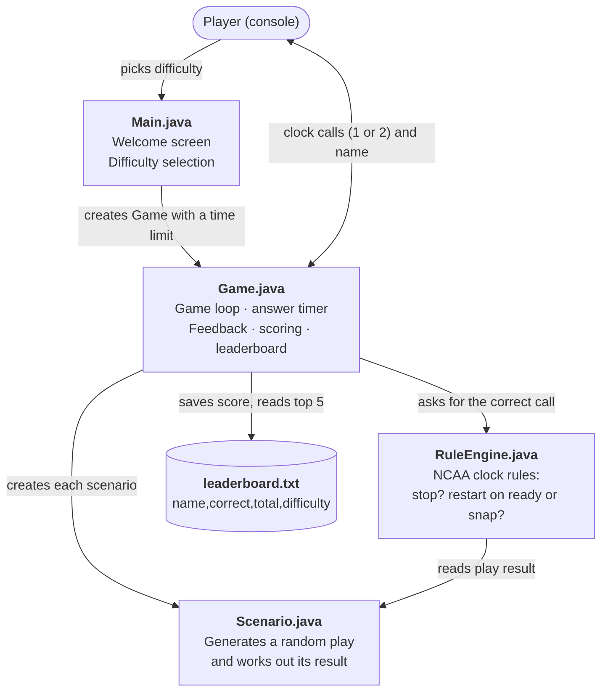

# NCAA-Ref-Sim
A simulator that tests football referees on game clock management in the final two minutes of a game.
## The Problem
As a football equipment manager for the Purdue Football team, I manage the game and play clock during practices. This includes game-like scenario where the team simulates a drive in the final two minutes of the game. During these simulations I have to be perfect on the clock and be able to make decisions for the game clock in an instant. However, as someone who has always watched NFL and not much college football, I quickly realized that the rules are a lot different than I thought. Hence, I decided to make this simulator so I, and anyone else with the same problem as me, can practice their ability to take in information and make quick decisions for the game clock.
## How It Works
Each game is 5 scenarios. For every scenario, the simulator generates a random play and situation in the final two minutes of the game. The simulator lists out what happened on the play and asks the player two questions; Should the clock stop, and if so, when does it restart? A rule engine works out the correct call by itself and compares that to the answer given by the player, while a timer checks that the player answered within the given time limit, decided by the difficulty the player selects at the start of the game. After 5 scenarios, the player sees their final score and can save it to a local leaderboard by inputting their name.

## Tech Stack
- **Language:** Java 25
- **Libraries:** Java Standard library only (java.util for randomness and lists, java.io for reading and writing the leaderboard, java's IO class for input and output)
- **External tools:** IntelliJ IDEA, Git, GitHub
- **Data storage:** leaderboard.txt, plain text file with one line separated by commas per game (name,correct,total,difficulty). 
## Setup
You need **Git** and **Java 25 or newer**.

1. **Install Java 25** Check that it worked:
```bash
java -version
```
The first line should say version `25` or higher.
2. **Clone the repository:**
```bash
git clone https://github.com/ArchitM124/NCAA-Ref-Sim.git
cd NCAA-Ref-Sim/src/main/java
```
3. **Run the game:**
```bash
java Main.java
```
## How to Play
1. Enter **1** for Regular (15 seconds per call) or **2** for Hard (10 seconds per call).
2. Read the scenario, then enter **1** to stop the clock or **2** to keep it running.
3. If the clock should stop enter **1** if it restarts on the referee's ready signal or **2** if it restarts on the snap.
4. After 5 scenarios, enter your name to save your score.

Each question correctly answered within the time limit earns 1 point. A correct answer that comes in late earns no point.

## Example
Real output from one game, with two earlier games already on the leaderboard. Lines with a single number or a name are what the player typed.

```text
Choose a difficulty:
1. Regular (15 seconds per call)
2. Hard (10 seconds per call)
Enter 1 or 2.
1
==================================
          GAME START
==================================

SCENARIO 1 OF 5
----------------------------------
Possession: HOME
Score: HOME 13 - AWAY 11
Clock before snap: 0:02
Clock after play: 0:01
Down: 3 and 1
Field position: Opponent's 34-yard line
Play type: PASS
Play result: COMPLETE
Yards gained: 12
Out of bounds: No

What should happen to the game clock?
1. Stop the game clock
2. Keep the game clock running
You have 15 seconds.
Enter your choice (1-2)
1
You took 0 seconds out of 15.
Correct! That's the right decision.

When should the game clock restart?
1. On the referee's ready signal
2. On the snap
When should the game clock restart? (1-2)
1
You took 0 seconds out of 15.
Correct! That's the right decision.

Play clock starts at 40.
Offense snaps with 13 seconds left on the play clock.
Game clock: 0:01 --> 0:00 at the next snap
Time expires before the snap. Ball Game.

...

==================================
           GAME OVER
==================================
Your final score: 7/10

Enter your name for the leaderboard:
Archit

========== LEADERBOARD ==========
1. Sam 7/9 (77%) Hard
2. Kyle 6/8 (75%) Regular
3. Archit 7/10 (70%) Regular
```
## Roadmap
**MVP**
- [x] Set up the Git repository and Java environment.
- [x] Create welcome and rules messages.
- [x] Display a simple scoreboard
- [x] Show the game clock before and after each play, and the play clock before each snap.
- [x] Create scenarios that explain the situation and ask user to manage the game clock.
- [x] Add multiple randomized scenarios with realistic yardage.
- [x] Implement a scoring system with a final result.
- [x] Add feedback text for each decision.
- [x] Test against NCAA clock rules and debug.

**Version 2**
- [x] Difficulty levels with a time limit for each call.
- [x] Local leaderboard that saves score and shows top 5 at the end of the game.

**Future**
- [ ] Add timeouts, penalties, and an option for players to manage between 40 and 25 second play clock.
- [ ] Add a live countdown that cuts the player off if they do not make a decision in time.
- [ ] Generate scenarios from real play-by-play data.

## Demo
coming soon...

## Author
Archit Mundada, github.com/ArchitM124
